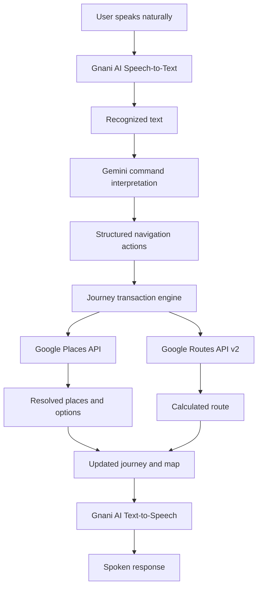

# Indie Maps

### Say it naturally. Navigate intelligently.

**Indie Maps** is a multilingual, voice-first conversational navigation assistant designed for the diversity of how people communicate across India. It enables users to plan and modify journeys through natural speech — including regional languages, Hinglish, and code-mixed commands — instead of relying on rigid search fields and manual route editing.

From understanding an ambiguous landmark-based request to managing multiple destinations and stops in a single conversation, Indie Maps turns everyday language into structured navigation actions and real-world routes.

---

## The problem

Most navigation experiences expect users to know exactly what to search for, manually select locations, and repeatedly edit their routes to accommodate changes.

But real-world instructions are rarely that structured.

A user might say:

- "Bangla Sahib ke paas chai ki tapri pe jaana hai."
- "Anna, Chennai Central poganum. Route-la oru coffee shop-um add pannunga!"
- "Ami Howrah Station jabo, rastay ekta mishti'r dokan add kore dao."

These are natural, contextual, and often multilingual instructions. They may include vague place descriptions, regional expressions, multiple actions, and implicit relationships between destinations and stops.

Indie Maps is built to understand these instructions and translate them into meaningful navigation operations.

## What Indie Maps does

### 1. Multilingual and code-mixed voice interaction

Users can communicate with Indie Maps in supported Indian languages and mixed-language expressions without needing to formulate commands in a rigid format.

The speech pipeline integrates **Gnani AI** for speech-to-text and text-to-speech, while the application processes the resulting commands through its navigation intelligence layer.

The language configuration includes:

- English
- Hindi
- Hinglish
- Tamil
- Telugu
- Kannada
- Malayalam
- Marathi
- Bengali
- Gujarati
- Punjabi

### 2. Understands ambiguous, landmark-based requests

Users do not always know the exact name of a business or location.

For example:

> "Find a tea stall near Bangla Sahib."

Instead of treating the landmark as the destination, Indie Maps separates the requested place category from the landmark used as a geographical anchor.

It then resolves the landmark, searches for relevant nearby businesses, applies geographic validation, and presents suitable options.

The user can select a result to make it the destination or add it as a stop, depending on the original instruction.

### 3. Understands multiple instructions in one conversation

A single command can contain multiple navigation operations.

For example:

> "Take me to Howrah Station and add a sweet shop along the way."

Indie Maps identifies the final destination separately from the intermediate stop, resolves the requested places, and updates the journey without silently replacing the intended destination.

The navigation action model supports operations such as:

- Setting or changing the origin and destination
- Adding, removing, and reordering stops
- Searching for nearby places
- Adding route-aware stops
- Changing travel preferences
- Requesting the current location
- Handling clarification and follow-up instructions

### 4. Context-aware conversational follow-ups

Navigation is not limited to a single command.

Users can continue the conversation with instructions such as:

- "Add the first one."
- "Take me to the second option."
- "Remove the second stop."
- "Keep the destination the same."
- "Show me more options."

The application maintains journey and clarification context to resolve these follow-ups against the current navigation state.

### 5. Real-time place discovery and route calculation

Indie Maps integrates Google Maps Platform APIs to connect conversational intent with real-world locations and routes.

It uses:

- **Google Places API (New)** for text-based and nearby place discovery.
- **Google Routes API v2** for route calculation, including intermediate waypoints.
- Route modifiers for preferences such as avoiding tolls and highways.
- Route-aware detour ranking to evaluate candidate stops against an existing journey.

The application supports driving and two-wheeler travel modes in its journey model.

---

## How it works

Indie Maps connects speech technology, language understanding, navigation logic, and mapping services in one workflow.



**Step 1 — Speech input:** The user gives a voice command through the application.

**Step 2 — Speech recognition:** Gnani AI's speech integration converts the audio input into text. A browser speech-recognition fallback is also available in the speech service.

**Step 3 — Command interpretation:** The backend uses Gemini to interpret the command, extract relevant place names, identify intent, and produce structured navigation actions. A local rule-based parser provides a fallback for supported command patterns.

**Step 4 — Navigation transaction:** The journey transaction engine applies the interpreted actions while preserving existing journey state and handling ambiguity or clarification where required.

**Step 5 — Place resolution and routing:** Google Places API resolves locations and discovers nearby businesses. Google Routes API v2 calculates the route using the selected origin, destination, and intermediate stops.

**Step 6 — Voice response:** Gnani AI's text-to-speech integration generates a spoken response to the user.

---

## Technology stack

| Layer                          | Technologies                                              |
| ------------------------------ | --------------------------------------------------------- |
| Frontend                       | React 19, TypeScript, Vite                                |
| Styling                        | Tailwind CSS 4                                            |
| Mapping                        | Google Maps JavaScript API, `@vis.gl/react-google-maps`   |
| Place discovery                | Google Places API (New)                                   |
| Routing                        | Google Routes API v2                                      |
| Command interpretation         | Google Gemini API                                         |
| Speech-to-text                 | Gnani AI / Vachana streaming STT                          |
| Text-to-speech                 | Gnani AI / Vachana Timbre TTS                             |
| Backend                        | Node.js, Express                                          |
| Real-time communication        | WebSockets                                                |
| Language and intent processing | TypeScript, multilingual parsing and translation services |

---

## Project architecture

```text
indie-maps/
│
├── public/
│   └── assets/
│
├── scripts/
│   ├── run-language-regression.ts
│   ├── run-qa-tests.ts
│   ├── test-gnani-integration.ts
│   ├── test-multilingual-gnani.ts
│   ├── test-destination-intelligence.ts
│   ├── test-multi-intent-acceptance.ts
│   ├── test-landmark-acceptance.ts
│   └── test-focused-acceptance.ts
│
├── src/
│   ├── components/
│   │   ├── Brand/
│   │   ├── Map/
│   │   ├── Navigation/
│   │   ├── TestModal/
│   │   └── Voice/
│   │
│   ├── config/
│   │   └── gnaniConfig.ts
│   │
│   ├── context/
│   │   └── JourneyContext.tsx
│   │
│   ├── server/
│   │   ├── api.ts
│   │   ├── envStorage.ts
│   │   └── gnaniProxy.ts
│   │
│   ├── services/
│   │   ├── aiService.ts
│   │   ├── anchorService.ts
│   │   ├── audioCapture.ts
│   │   ├── conversationContext.ts
│   │   ├── detourService.ts
│   │   ├── gnaniSttClient.ts
│   │   ├── gnaniTtsClient.ts
│   │   ├── journeyTransaction.ts
│   │   ├── placesService.ts
│   │   ├── routesService.ts
│   │   ├── speechService.ts
│   │   ├── translationService.ts
│   │   └── testFixtures.ts
│   │
│   ├── types/
│   │   └── navigation.ts
│   │
│   ├── utils/
│   │   ├── polyline.ts
│   │   └── transliteration.ts
│   │
│   ├── App.tsx
│   ├── index.css
│   └── main.tsx
│
├── .env.example
├── .gitignore
├── index.html
├── package.json
├── server.ts
├── tsconfig.json
└── vite.config.ts
```

### Important modules

| Module                   | Responsibility                                                                 |
| ------------------------ | ------------------------------------------------------------------------------ |
| `aiService.ts`           | Interprets natural-language commands and extracts navigation intent.           |
| `journeyTransaction.ts`  | Executes structured actions while maintaining journey consistency.             |
| `conversationContext.ts` | Maintains pending clarifications and conversational context.                   |
| `placesService.ts`       | Resolves places, performs nearby searches, and validates geographic relevance. |
| `anchorService.ts`       | Resolves the geographical anchor for contextual searches.                      |
| `detourService.ts`       | Evaluates and ranks route-relative stop candidates.                            |
| `routesService.ts`       | Requests and processes route calculations.                                     |
| `speechService.ts`       | Coordinates speech recognition, speech synthesis, and browser fallback.        |
| `gnaniSttClient.ts`      | Handles Gnani AI streaming speech-to-text communication.                       |
| `gnaniTtsClient.ts`      | Handles Gnani AI text-to-speech communication.                                 |
| `gnaniProxy.ts`          | Provides server-side proxying for Gnani speech connections and credentials.    |
| `JourneyContext.tsx`     | Manages application-wide journey, route, navigation, and voice state.          |

---

## Getting started

### Prerequisites

- Node.js **22.6.0 or later**
- npm
- Google Maps Platform API key with the required Maps JavaScript, Places API (New), and Routes API access
- Google Gemini API key
- Gnani AI / Vachana API key for the speech features

### 1. Clone the repository

```bash
git clone https://github.com/YOUR-USERNAME/indie-maps.git
cd indie-maps
```

Replace `YOUR-USERNAME` with the GitHub account or organization hosting the repository.

### 2. Install dependencies

```bash
npm install
```

### 3. Configure environment variables

Create a `.env` file in the project root using `.env.example` as a template.

```env
# Google Maps Platform
VITE_GOOGLE_MAPS_API_KEY=your_google_maps_api_key

# Google Gemini
GEMINI_API_KEY=your_gemini_api_key
GEMINI_MODEL=gemini-3.5-flash-lite

# Gnani AI / Vachana
GNANI_API_KEY=your_gnani_api_key
GNANI_TTS_VOICE=your_tts_voice
GNANI_TTS_MODEL=timbre-v2.5

# Server
PORT=3000
```

Use valid credentials from the respective providers. The Gemini model can be configured through `GEMINI_MODEL`; the backend also has candidate-model fallback behavior.

**Important security notes:**

- Never commit `.env` or any file containing actual API credentials.
- Keep Gemini and Gnani credentials on the server side.
- Restrict the Google Maps browser key to the required APIs and authorized application origins.
- Do not expose API keys in screenshots, recordings, logs, or public documentation.
- `.env.example` should contain placeholders only.

### 4. Start the development server

```bash
npm run dev
```

The application is configured to run the development server on port `3000` by default.

Open:

```text
http://localhost:3000
```

Grant location and microphone permissions when prompted. Voice functionality and live map operations require valid provider credentials and the relevant browser permissions.

---

## Available scripts

The project includes scripts for language regression, speech integration, destination interpretation, and navigation acceptance testing.

| Command                                | Purpose                                                      |
| -------------------------------------- | ------------------------------------------------------------ |
| `npm run lint`                         | Runs the TypeScript compiler without emitting files.         |
| `npm run build`                        | Builds the frontend for production.                          |
| `npm run test:language`                | Runs language and navigation regression cases.               |
| `npm run test:tts-parser`              | Tests Gnani TTS message and audio-chunk parsing.             |
| `npm run test:gnani`                   | Runs multilingual Gnani integration tests.                   |
| `npm run test:destination`             | Tests destination intelligence.                              |
| `npm run test:multi-intent-acceptance` | Tests compound navigation intent and journey actions.        |
| `npm run test:landmark`                | Tests landmark-anchored nearby search and journey integrity. |

Additional focused test scripts can be run directly:

```bash
npx tsx scripts/test-focused-acceptance.ts
npx tsx scripts/test-gnani-integration.ts
npx tsx scripts/test-multilingual-gnani.ts
```

Some tests exercise local parsing and transaction logic, while live integrations require valid API credentials and network access. A successful local test does not by itself verify live provider availability.

---

## Key design considerations

### Landmark search is not destination resolution

A request such as "Find a cafe near GTBIT" contains two different pieces of information:

- **Search subject:** cafe
- **Geographical anchor:** Guru Tegh Bahadur Institute of Technology

The application models these separately through `SEARCH_NEARBY`, `searchAnchor`, and `anchorPlaceQuery`. This prevents the landmark from being incorrectly committed as the destination.

### Journey updates are transactional

Commands can contain multiple actions. The transaction engine consolidates these actions and maintains the existing origin, destination, and stops unless the user's instruction explicitly changes them.

When an instruction is ambiguous, the application can request clarification instead of silently applying an uncertain change.

### Geographic validation matters

Nearby results are checked against the resolved landmark's coordinates and configured search radius. The implementation includes distance calculations and validation to reject unsuitable candidates, including results that are geographically inconsistent with the requested anchor.

### Route-relative discovery is different from landmark discovery

A request for a business near a named landmark uses the landmark-search pipeline.

A request for a place along an existing journey uses the route-relative discovery and detour-ranking pipeline.

Keeping these workflows separate helps the application distinguish proximity to a landmark from convenience along a route.

---

## Current scope and limitations

Indie Maps is an actively developed project. Its behavior depends on the configured speech, language-model, and mapping services.

- Live place discovery and route calculations require valid Google Maps Platform credentials and enabled API access.
- Gnani AI speech features require a valid Gnani API key and supported language/model configuration.
- Gemini-based interpretation requires a valid Gemini API key. The local parser provides fallback behavior for supported patterns, but it is not a replacement for full language-model interpretation.
- Speech recognition quality can vary with background noise, accents, microphone quality, and code-mixing.
- Browser microphone and geolocation permissions are required for their respective features.
- Search results, business ratings, availability, and routes are subject to the underlying provider's data and coverage.
- This repository does not claim that every possible regional dialect or natural-language expression is supported perfectly.

---

## Roadmap

Potential areas for further development include:

- Broader evaluation across regional accents and code-mixed speech.
- Improved handling of ambiguous and multi-step conversational instructions.
- Expanded language-specific regression and acceptance datasets.
- More robust route-aware recommendations and detour optimization.
- Improved voice interaction and navigation feedback.
- Deployment, reliability, and performance improvements.

---

## Acknowledgements

Indie Maps integrates services and technologies from:

- **Gnani AI / Vachana** — multilingual speech recognition and speech synthesis.
- **Google Gemini** — natural-language command interpretation.
- **Google Maps Platform** — place discovery, mapping, and route calculation.
- **React, TypeScript, Vite, and Express** — application and backend infrastructure.

---

## Project

**Indie Maps — Say it naturally. Navigate intelligently.**

Built to make conversational navigation more accessible, intuitive, and useful across India's linguistic diversity.
